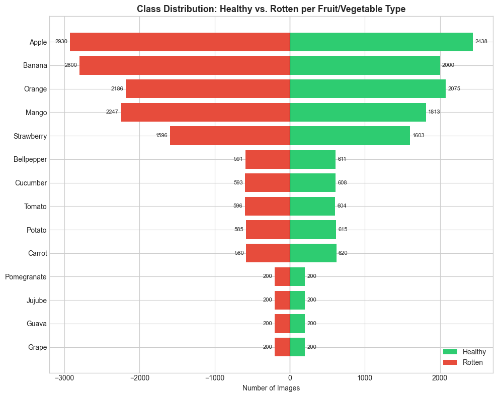
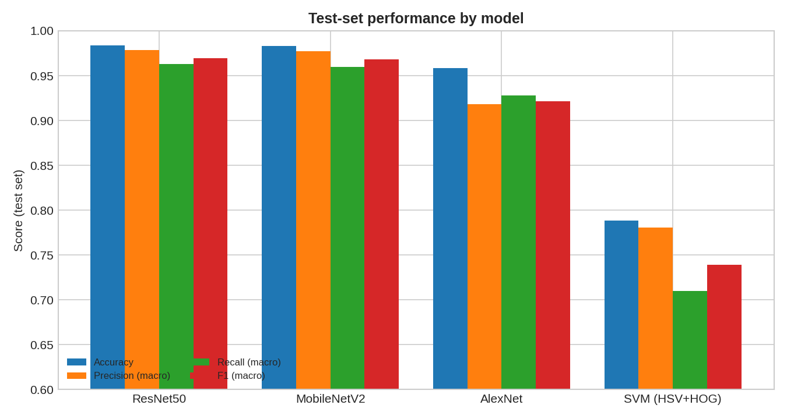
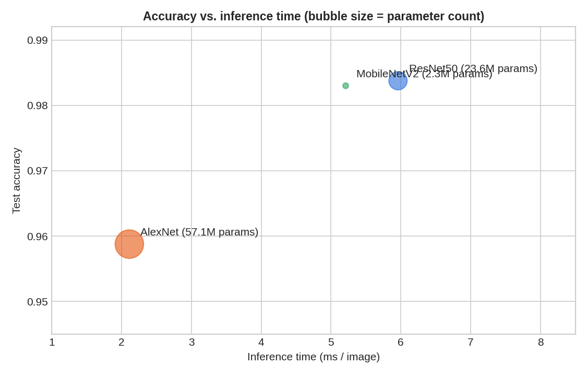
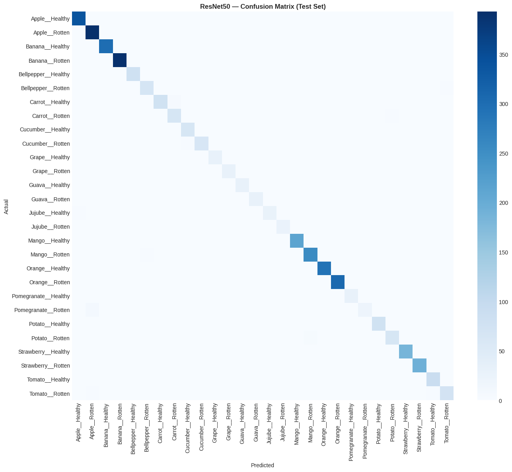

# 🍎🥦 Fruit & Vegetable Freshness Classification

**Healthy vs. Rotten — a comparison of classical computer vision and transfer learning (AlexNet, ResNet50, MobileNetV2)**


An end-to-end image classification project that decides whether a fruit or vegetable is **healthy or rotten** and which of 14 produce types it is (28 classes in total). The project compares a handcrafted-feature baseline (HSV histograms + HOG → SVM) against three ImageNet-pretrained CNNs fine-tuned with the same two-stage protocol, under an identical, deduplicated data split.

> **Headline result:** ResNet50 reaches **98.38 %** test accuracy (macro-F1 0.969), with MobileNetV2 essentially tied at **98.30 %** while using ~10× fewer parameters. The classical baseline reaches 78.85 %.

---

## Table of Contents

- [Dataset](#dataset)
- [Pipeline](#pipeline)
- [Results](#results)
- [Key Findings](#key-findings)
- [Limitations](#limitations)
- [Repository Structure](#repository-structure)
- [Getting Started](#getting-started)
- [Team](#team)
- [Acknowledgements](#acknowledgements)

---

## Dataset

**[Fruit and Vegetable Disease (Healthy vs Rotten)](https://www.kaggle.com/datasets/muhammad0subhan/fruit-and-vegetable-disease-healthy-vs-rotten)** — Kaggle (`muhammad0subhan`).

- 14 produce types × {Healthy, Rotten} = **28 classes**: Apple, Banana, Bellpepper, Carrot, Cucumber, Grape, Guava, Jujube, Mango, Orange, Pomegranate, Potato, Strawberry, Tomato.
- Highly variable image sizes (701 distinct resolutions in a sample of the data) and a clear class imbalance: Apple and Banana have thousands of images, while Grape, Guava, Jujube and Pomegranate have only a few hundred.



The dataset is **not** included in this repository. The notebook downloads it automatically through `kagglehub` (see [Getting Started](#getting-started)). Please refer to the dataset page for its license and terms of use.

---

## Pipeline

### 1. Data quality & EDA
- Integrity check of image files (no corrupt files found in the sampled check).
- Visual and statistical colour analysis (RGB/HSV) of healthy vs. rotten samples.
- **Deduplication before splitting**, to prevent train/test leakage:

  | Stage | Images |
  |---|---:|
  | Indexed | 29,277 |
  | After exact-duplicate removal (MD5) | 27,502 |
  | After near-duplicate removal (perceptual hash) | **25,868** |

- **Stratified 70 / 15 / 15 split** (seed 42): 18,107 train / 3,880 validation / 3,881 test. Split files and the class-to-index mapping are saved once and shared by every model so all comparisons use identical data.

### 2. Imbalance-aware augmentation (training set only)
- All images resized to 224×224 and normalised with ImageNet statistics.
- Horizontal flip and ±15° rotation for all classes.
- Vertical flip only for round/symmetric produce (Apple, Orange, Grape, Guava, Pomegranate, Tomato).
- **Stronger augmentation for the four low-volume types** (Grape, Guava, Jujube, Pomegranate): ±30° rotation, colour jitter, random affine (translation + scale).
- Validation and test sets use resize + normalisation only.

### 3. Classical baseline
- Features: 96-dim HSV colour histogram (32 bins × 3 channels) + HOG (6,084 dims) → **6,180 features**, standardised with `StandardScaler` (fit on train only).
- Models: Logistic Regression (val. acc. 67.71 %) and RBF-SVM, `C=10` (val. acc. 79.30 %). The SVM was selected on **validation** accuracy.

### 4. Transfer learning (AlexNet, ResNet50, MobileNetV2)
All three models use the same shared training code and the same two-stage protocol:

| Stage | What is trained | Optimiser | Epochs |
|---|---|---|---:|
| 1 — Feature extraction | New classification head only (backbone frozen) | Adam, lr = 1e-3 | 5 |
| 2 — Full fine-tuning | All layers | Adam, lr = 1e-4, `ReduceLROnPlateau` (factor 0.5, patience 2) | 10 |

Loss: cross-entropy · Batch size: 32 · Input: 224×224 · Weights: ImageNet-1k (torchvision).

### 5. Evaluation
Accuracy, macro precision / recall / F1, per-class analysis, confusion matrices, most-confused class pairs, minority-class analysis, parameter count, training time and inference time per image. The test set is used for final reporting only.

---

## Results

Test-set results (3,881 images), taken from the model-comparison table in the notebook:

| Rank | Model | Type | Accuracy | Precision (macro) | Recall (macro) | F1 (macro) | Parameters | Train time (s) | Inference (ms/img) |
|---:|---|---|---:|---:|---:|---:|---:|---:|---:|
| 1 | **ResNet50** | Deep learning | **0.9838** | 0.9786 | 0.9630 | **0.9693** | 23.6 M | 4,284 | 5.96 |
| 2 | **MobileNetV2** | Deep learning | 0.9830 | 0.9772 | 0.9598 | 0.9679 | **2.3 M** | 3,853 | 5.21 |
| 3 | AlexNet | Deep learning | 0.9588 | 0.9182 | 0.9279 | 0.9216 | 57.1 M | 3,723 | **2.11** |
| 4 | SVM (HSV + HOG) | Classical ML | 0.7885 | 0.7805 | 0.7100 | 0.7390 | n/a¹ | 1,769 | 130.49² |

<sup>¹ The notebook reports a proxy for the kernel SVM (support vectors × feature dimension), which is not comparable to a neural-network parameter count.
² Includes handcrafted feature extraction (HSV + HOG) plus prediction on CPU. Training and inference times were measured in different environments for the classical and deep-learning models, so treat them as indicative rather than strictly comparable.</sup>





### Confusion matrix — ResNet50 (best model)



### Effect of class imbalance (average F1)

| Model | Minority types¹ | Other types | Gap |
|---|---:|---:|---:|
| AlexNet | 0.872 | 0.941 | 0.069 |
| ResNet50 | 0.960 | 0.973 | 0.013 |
| MobileNetV2 | 0.958 | 0.972 | 0.014 |

<sup>¹ Grape, Guava, Jujube, Pomegranate.</sup>

---

## Key Findings

1. **Transfer learning dominates handcrafted features.** The best CNNs improve on the HSV + HOG + SVM baseline by roughly 19–20 accuracy points, and, in the reported measurements, are more than 20× faster per image at inference than the classical pipeline (which pays for feature extraction on every image).
2. **MobileNetV2 is the best accuracy-per-parameter trade-off.** It is within 0.08 percentage points of ResNet50 (about 3 test images, well inside run-to-run noise) with roughly 10× fewer parameters and slightly lower latency. For deployment on constrained devices it is the more attractive choice; ResNet50 has a small edge in macro-F1 and minority-class stability.
3. **AlexNet is the fastest but noticeably less accurate**, especially on macro-precision (0.918), and shows the largest gap on the low-volume classes.
4. **The hardest class is `Pomegranate__Rotten`** (F1 = 0.80, only 30 test images), most often misclassified as `Apple__Rotten`. Other weak classes are rotten Bellpepper, Potato, Carrot and Tomato.
5. **Colour carries signal but is not enough.** In the sampled EDA, rotten images had lower mean saturation than healthy ones (≈ 65.9 vs 84.4), yet the colour + gradient baseline still confuses many healthy/rotten pairs (e.g. Apple, Banana, Strawberry, Orange).
6. **Class size correlates only moderately with per-class F1** (correlation ≈ 0.40 for ResNet50), suggesting that visual similarity between classes matters in addition to data volume.

---

## Limitations

- **Single run, single split, single seed.** No confidence intervals or repeated runs; small differences between ResNet50 and MobileNetV2 should not be over-interpreted.
- **In-distribution evaluation only.** The test set comes from the same dataset as training. Performance on photos from other sources (different lighting, backgrounds, cameras) has not been measured.
- **Near-duplicate removal is heuristic** (perceptual-hash exact match), so some visually similar images may remain, and some distinct-but-similar images may have been removed.
- **Class imbalance is handled through augmentation only** (no class weighting or resampling).
- **Timing numbers are environment-dependent** (see footnote under the results table).

---

## Repository Structure

```
.
├── Organized_Fruit_Vegetable_Freshness_Classification.ipynb   # full pipeline: EDA → models → comparison
├── assets/                                                    # figures used in this README
├── requirements.txt
├── .gitignore
└── README.md
```

Running the notebook also creates the following folders locally (they are git-ignored because they are large or machine-specific): `splits/`, `features/`, `models/`, `metrics/`.

---

## Getting Started

### 1. Clone and install

```bash
git clone https://github.com/<your-username>/<your-repo>.git
cd <your-repo>

python -m venv .venv
source .venv/bin/activate        # Windows: .venv\Scripts\activate
pip install -r requirements.txt
```

### 2. Dataset access

The notebook downloads the dataset with [`kagglehub`](https://github.com/Kaggle/kagglehub). Depending on your setup you may need to authenticate with Kaggle first (see the kagglehub documentation).

### 3. Run

```bash
jupyter lab
```

Open `Organized_Fruit_Vegetable_Freshness_Classification.ipynb` and **run the cells from top to bottom**. Sections 2–6 read the split files written by Section 1 (`splits/*.csv`, `splits/class_to_idx.json`, `splits/augmentation_config.json`), so Section 1 must run first.

**Notes**
- A CUDA-capable GPU is strongly recommended for Sections 3–5 (full fine-tuning of each network took roughly an hour in our runs). The classical baseline runs on CPU, but feature extraction and SVM training are slow (SVM training alone took ~34 minutes on a local CPU).
- With scikit-learn ≥ 1.5, `LogisticRegression(multi_class=...)` emits a deprecation `FutureWarning`; it does not affect results.

---

## Team

This project was completed as a six-person team, with each member owning one section of the notebook.

| # | Member | Responsibility |
|---|---|---|
| 1 | Somia | Data & EDA |
| 2 | Rawan | Classical CV baseline |
| 3 | Hend | Transfer learning — AlexNet |
| 4 | Menna | Transfer learning — ResNet50 |
| 5 | Tasneem | Transfer learning — MobileNetV2 |
| 6 | Toqa | Evaluation & comparison |

---

## Acknowledgements

- Dataset: [Fruit and Vegetable Disease (Healthy vs Rotten)](https://www.kaggle.com/datasets/muhammad0subhan/fruit-and-vegetable-disease-healthy-vs-rotten) by `muhammad0subhan` on Kaggle.
- Pretrained weights: [torchvision](https://pytorch.org/vision/stable/models.html) ImageNet-1k models (AlexNet, ResNet50, MobileNetV2).
- Libraries: PyTorch, torchvision, scikit-learn, scikit-image, OpenCV, imagehash, pandas, NumPy, Matplotlib, Seaborn.
